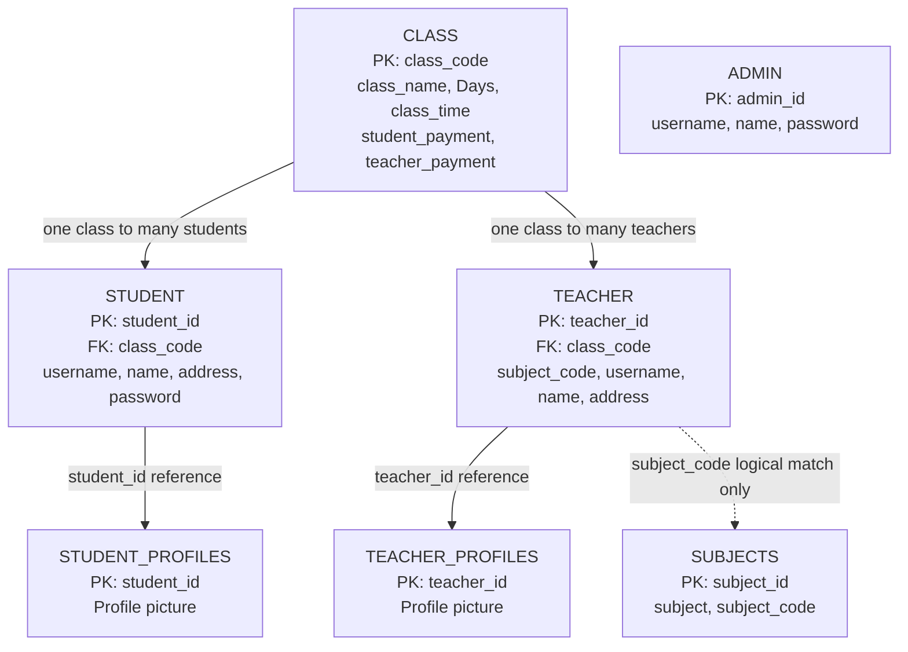

# Sirius – Database ER Diagram

This diagram represents the tables and declared foreign-key relationships in the supplied SQL schema.

## Relationship notes

- One class can be associated with multiple students through `student.class_code`.
- One class can be associated with multiple teachers through `teacher.class_code`.
- `student_profiles.student_id` references `student.student_id`.
- `teacher_profiles.teacher_id` references `teacher.teacher_id`.
- `teacher.subject_code` corresponds conceptually to `subjects.subject_code`, but the supplied SQL dump does not declare a foreign-key constraint for this relationship. The dotted arrow indicates a logical match, not an enforced foreign key.
- `admin` and `subjects` are standalone in the declared foreign-key structure.
- Payment amounts are stored as fields in `class`; the supplied schema does not define separate payment tables.

> This diagram documents the supplied database schema. It is not a redesigned or normalized schema.
